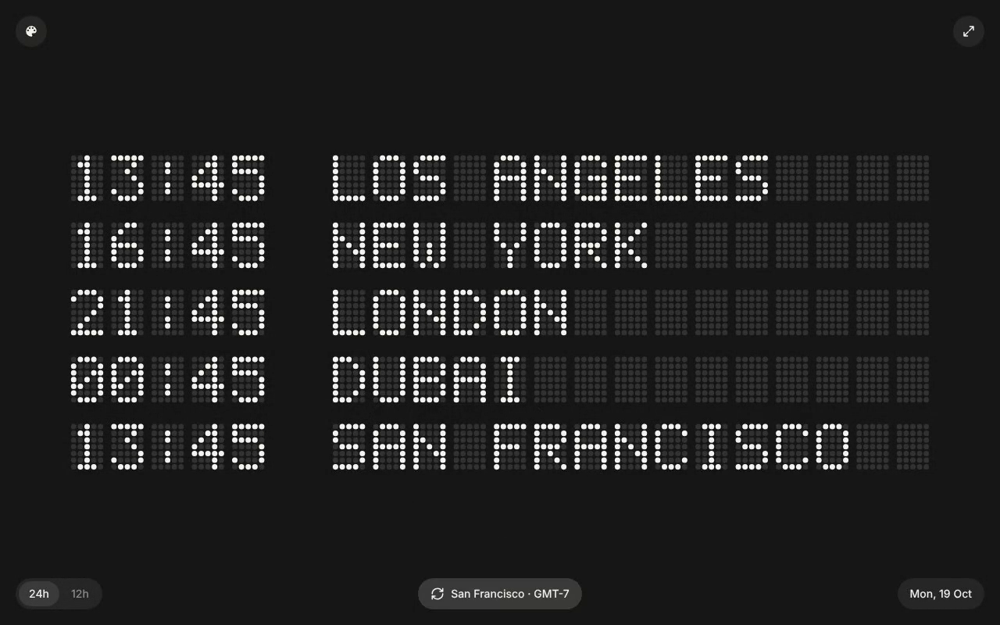
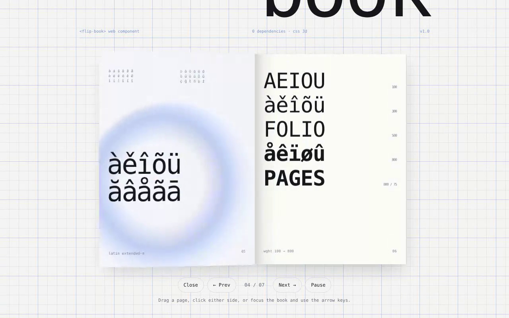
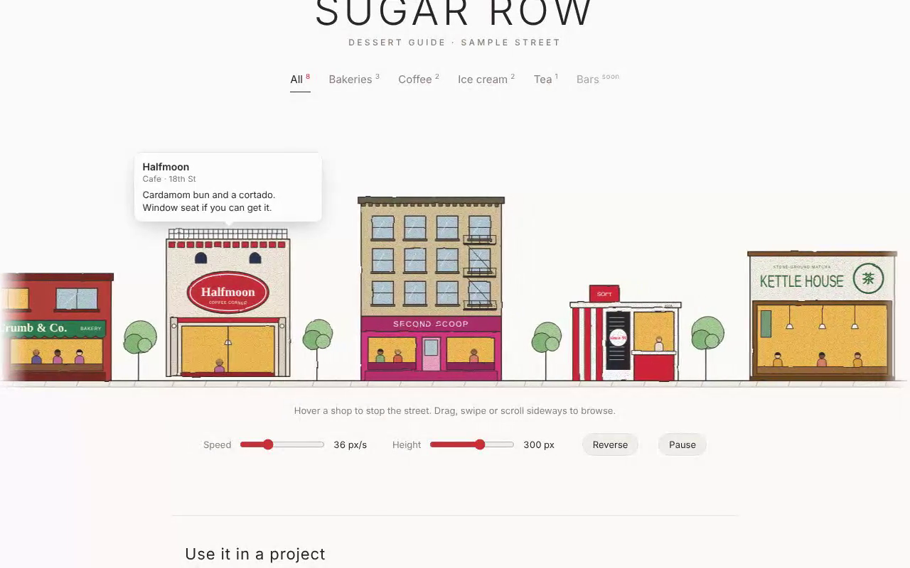
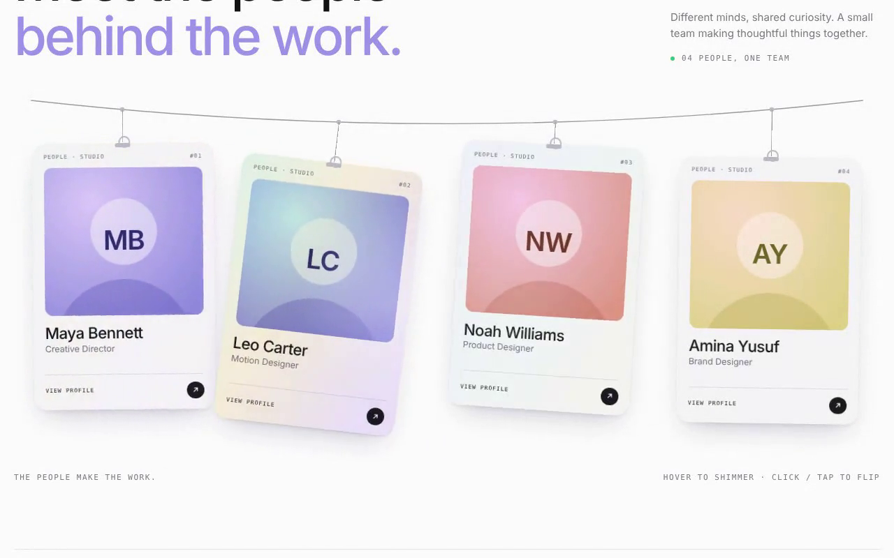
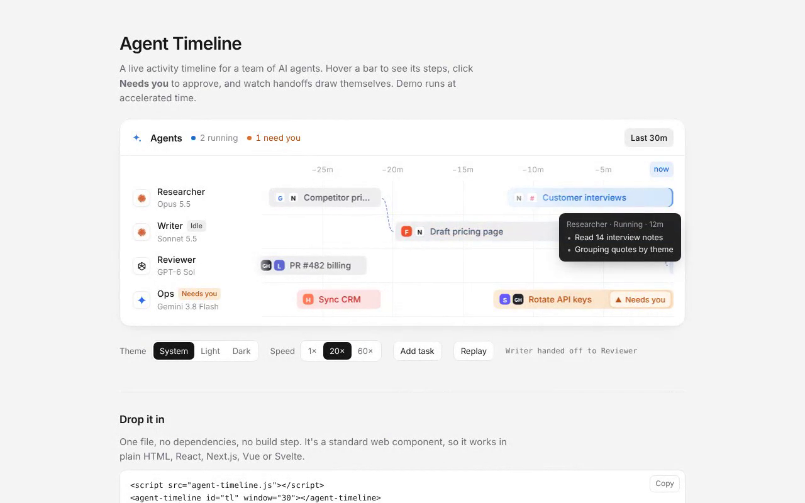
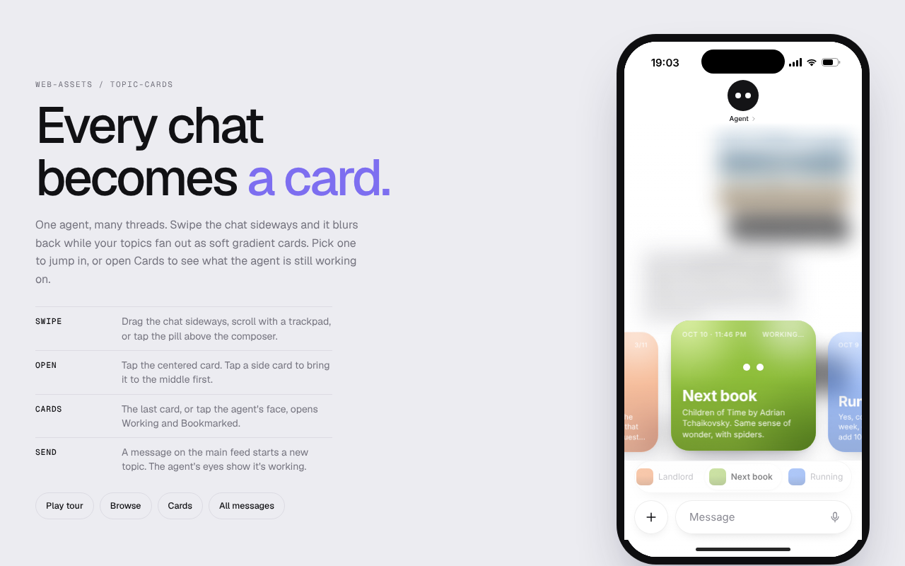
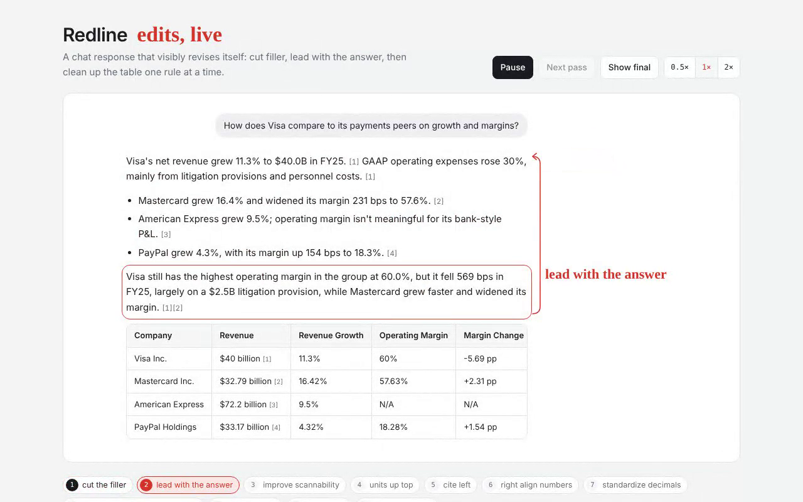
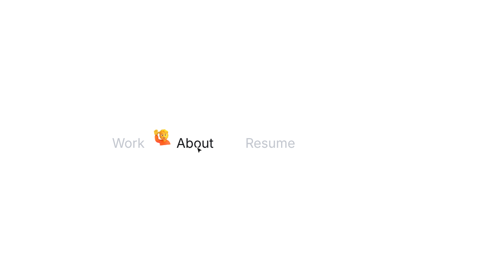
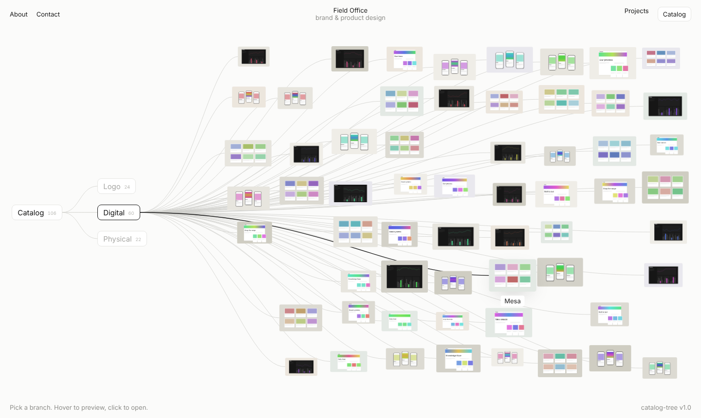

# web-assets

Reusable web components and UI pieces I build once and drop into future projects. Each asset is self-contained: copy its folder, load the file, done. No build step, no dependencies. Every asset is a standard Web Component (or a tiny class), so it works in plain HTML, React, Next, Vue or Svelte.

## Assets

| Asset | What it is | Preview |
|---|---|---|
| [fids-board](assets/fids-board) | Dot-matrix departures board. Scramble-then-settle flip animation, synthesized flap sound, dots or pixels, any color. Ships with a world clock. |  |
| [flip-book](assets/flip-book) | 3D page-curl book. Any HTML element is a page; drag, click, keys or autoplay. Pure CSS 3D. |  |
| [storefront-street](assets/storefront-street) | Endless hand-drawn street of storefronts from JSON. Seven building types, tooltips, drag to browse, night mode. |  |
| [hanging-badges](assets/hanging-badges) | Team ID badges on a rope. Spring-physics sway, holographic shimmer, flip to a profile back with a QR code. |  |
| [agent-timeline](assets/agent-timeline) | Live activity timeline for AI agents. Running bars, step tooltips, approve/reject popovers, handoff links. |  |
| [topic-cards](assets/topic-cards) | Agent chat where every conversation becomes a gradient card. Swipe to fan topics out over a blurred chat, open one, or see Working and Bookmarked in a grid. |  |
| [redline](assets/redline) | Chat answer that visibly edits itself. CriticMarkup passes, margin notes, moving blocks, table cleanup. |  |
| [emoji-nav](assets/emoji-nav) | Quiet nav links that light up while a 3D emoji springs in beside them. Hover, focus or current page, any side, any colors. Pure CSS motion. |  |
| [catalog-tree](assets/catalog-tree) | Portfolio catalog as a branching tree. Category pills fan out into a scattered thumbnail field on spring-animated curves; hover to lift, click for a blurred-backdrop lightbox. |  |

Sites I pull ideas from live in [REFERENCES.md](REFERENCES.md).

## Using an asset

Every asset folder has the same layout:

```
assets/<name>/
  <name>.js     the reusable piece
  index.html    working demo
  README.md     API, options, examples
  demo/         video, GIF preview, screenshot
```

Run any demo by serving its folder (ES modules don't load from `file://`):

```bash
cd assets/fids-board && npx serve .
```

Or load straight from this repo via jsDelivr:

```html
<!-- most assets are plain scripts -->
<script src="https://cdn.jsdelivr.net/gh/kabirrgrover/web-assets@main/assets/flip-book/flip-book.js"></script>

<!-- fids-board is an ES module -->
<script type="module" src="https://cdn.jsdelivr.net/gh/kabirrgrover/web-assets@main/assets/fids-board/fids-board.js"></script>
```

For production, pin a commit instead of `@main` so updates here never change a live site.

## Adding a new asset

1. Make `assets/<name>/` following the layout above.
2. Record a short demo into `demo/` (`demo.mp4`, `preview.gif`, `screenshot.png`).
3. Add a row to the table above.

## License

MIT
