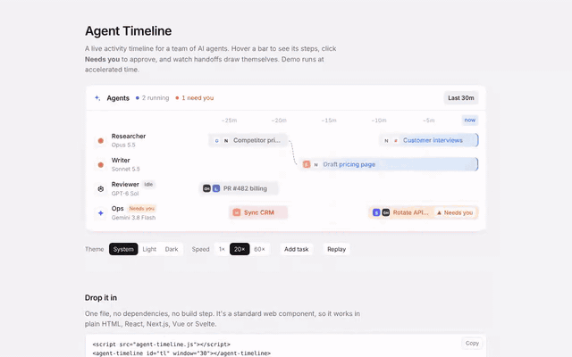

# agent-timeline



Full walkthrough: [demo/demo.mp4](demo/demo.mp4)

A live, scrolling activity timeline for a team of AI agents, as a Web Component. Bars grow toward "now" while tasks run, hover shows the steps, "Needs you" bars open an approve/reject popover, and handoffs between agents draw dashed links. Light and dark themes. Zero dependencies.

```
agent-timeline.js   the component (classic script, ~33 KB)
index.html          demo: four agents running a scripted story at 20x speed
demo/               walkthrough video, GIF preview, screenshot
```

## Use it

```html
<script src="agent-timeline.js"></script>
<agent-timeline id="tl" window="30"></agent-timeline>

<script>
  const tl = document.getElementById('tl');
  tl.setData({
    agents: [
      { id: 'res', name: 'Researcher', model: 'Opus 5.5', avatar: { glyph: 'burst', color: '#d4683f' } },
      { id: 'ops', name: 'Ops', model: 'Gemini 3.8 Flash', avatar: { glyph: 'spark', color: '#2f6bf0' } },
    ],
    tasks: [
      { id: 'a', agent: 'res', title: 'Competitor pricing', icons: ['google', 'notion'],
        startMin: -28, endMin: -19, status: 'done' },
      { id: 'b', agent: 'res', title: 'Customer interviews', icons: ['notion', 'slack'],
        startMin: -9, status: 'running', steps: ['Read 14 interview notes', 'Grouping quotes by theme'] },
      { id: 'c', agent: 'ops', title: 'Rotate API keys', icons: ['stripe', 'github'],
        startMin: -11, status: 'needs-input',
        prompt: { title: 'Rotate API keys', body: 'Rotate the production Stripe and OpenAI keys?' } },
    ],
  });
  tl.addEventListener('task-approve', e => console.log('approved', e.detail.task.id));
</script>
```

## Task fields

| field | type | what it does |
|---|---|---|
| `id` | string | unique key, auto-generated if missing |
| `agent` | string | agent id this bar sits on |
| `title` | string | bar label |
| `status` | enum | `running`, `done`, `failed`, `needs-input`, `queued` |
| `start` / `end` | ms or Date | leave `end` empty for live tasks |
| `startMin` / `endMin` | number | minutes relative to now (`-9` = 9 minutes ago) |
| `icons` | string[] | tool keys shown before the title |
| `steps` | string[] | bullets in the hover tooltip |
| `after` | string[] | task ids this depends on (draws a handoff link) |
| `prompt` | object | `{ title, body, approveLabel, rejectLabel }` for the approval popover |

## Methods and events

- `setData({ agents, tasks })`, `addTask(task)`, `updateTask(id, patch)`, `completeTask(id, handoff?)`, `removeTask(id)`, `addAgent`, `removeAgent`, `clear()`
- `windowMinutes`, `speed`, `ranges`: visible window, clock multiplier, presets for the "Last 30m" pill
- Events: `task-approve`, `task-reject` (cancelable), `task-click`, `task-hover`

Attributes: `theme`, `window`, `speed`, `title`, `row-height`. CSS hooks: `--at-font`, `--at-radius`, `--at-label-width`, `::part(card)`. Swap monogram icons for real logos with `AgentTimeline.registerIcon('notion', { src: '/logos/notion.svg' })`.

## React

```jsx
import './agent-timeline.js';
import { useEffect, useRef } from 'react';
export function AgentsPanel({ agents, tasks }) {
  const ref = useRef(null);
  useEffect(() => { ref.current?.setData({ agents, tasks }); }, [agents, tasks]);
  return <agent-timeline ref={ref} window="30" />;
}
```
