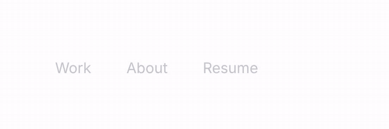

# emoji-nav



Full walkthrough: [demo/demo.mp4](demo/demo.mp4)

Nav links that sit quiet in light grey until you point at one. The label turns to ink and an emoji springs up beside it, tilted like a sticker. Mouse, keyboard focus and the current page all trigger it. Pure CSS motion, zero dependencies.

```
emoji-nav.js   the component (classic script, ~9 KB)
index.html     demo: hero, live tuning panel with copyable code, variants, reference
demo/          walkthrough video, GIF preview, screenshot
```

## Use it

```html
<script src="emoji-nav.js"></script>

<emoji-nav>
  <a href="/work"   data-emoji="💼">Work</a>
  <a href="/about"  data-emoji="🙋">About</a>
  <a href="/resume" data-emoji="📝">Resume</a>
</emoji-nav>
```

Every direct child becomes an item: links, buttons, spans, anything. Give each a `data-emoji`, or a `data-icon` image URL for a custom icon (a headshot, a logo). The emoji sits outside the label, so the text never shifts when it appears.

## Attributes

| attribute | default | meaning |
|---|---|---|
| `data-emoji` | | on an item: the emoji that pops in |
| `data-icon` | | on an item: an image URL instead (wins over `data-emoji`) |
| `emoji-set` | `fluent` | `fluent` = Microsoft Fluent 3D emoji images (MIT), same look on every OS. `native` = system emoji font, no network |
| `emoji-base` | jsDelivr | self-host the Fluent set: a folder of `<codepoints>.webp`, e.g. `/emoji/1f4bc.webp` |
| `side` | `left` | `left` or `right` of the label |
| `show-current` | off | keeps the `aria-current` item lit until another one is hovered |

If a Fluent image fails to load (offline, blocked CDN, emoji not in the set), that item quietly falls back to the native emoji.

## Styling

```css
emoji-nav {
  font-size: 24px;          /* everything scales from this */
  --en-idle: #c3c7cf;       /* resting label color */
  --en-ink: #111216;        /* lit label color */
  --en-gap: 2.4em;          /* space between items */
  --en-size: 1.45em;        /* emoji size relative to the label */
  --en-tilt: -6deg;         /* where the emoji settles */
  --en-from-tilt: -22deg;   /* where it springs in from */
  --en-in: 300ms;           /* enter */
  --en-out: 180ms;          /* exit */
}
```

Defaults are zero-specificity, so any rule you write wins. Vertical sidebar: `emoji-nav { flex-direction: column; align-items: flex-start }`. The element pads its leading side by one emoji width so the first icon has room; override `padding-inline` if your layout already leaves space. Dark backgrounds just need `--en-idle` and `--en-ink`.

Respects `prefers-reduced-motion` (fade only, no spring).

## Events

```js
nav.addEventListener('emojinav:enter', e => e.detail); // { item, index }
nav.addEventListener('emojinav:leave', e => e.detail);
```

## React / Next

```jsx
'use client';
import { useEffect } from 'react';

export function Nav() {
  useEffect(() => { import('./emoji-nav.js'); }, []);
  return (
    <emoji-nav>
      <a href="/work" data-emoji="💼">Work</a>
      <a href="/about" data-emoji="🙋">About</a>
      <a href="/resume" data-emoji="📝">Resume</a>
    </emoji-nav>
  );
}
```

Works with `<Link>` too, since any child element becomes an item. The component watches its children, so items React adds or swaps later are picked up automatically.

## Credits

3D emoji: [Microsoft Fluent Emoji](https://github.com/microsoft/fluentui-emoji) (MIT), served via the `@lobehub/fluent-emoji-3d` npm package.
