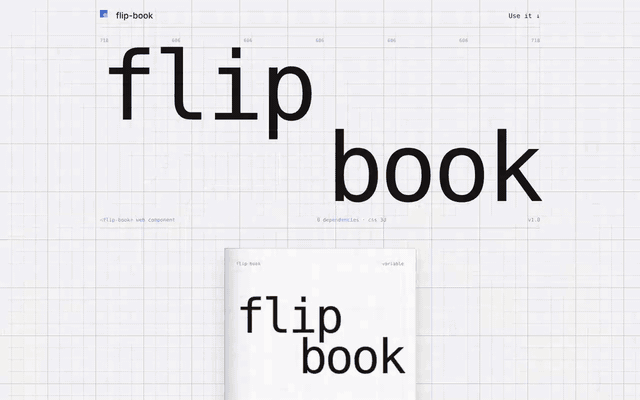

# flip-book



Full walkthrough: [demo/demo.mp4](demo/demo.mp4)

A 3D page-curl book as a Web Component. Any HTML element can be a page. Pages bend as they turn, the stack gets thicker on each side, and covers can be stiff. Zero dependencies, pure CSS 3D transforms.

```
flip-book.js   the component (classic script, ~21 KB)
index.html     demo: a type-specimen book with controls and docs
demo/          walkthrough video, GIF preview, screenshot
```

## Use it

```html
<script src="flip-book.js"></script>

<flip-book autoplay interval="1800" ratio="0.72">
  <section data-hard>Cover</section>
  <section>Inside cover</section>
  <section>Page 2</section>
  <section>Page 3</section>
  <section data-hard>Back cover</section>
</flip-book>
```

Every direct child becomes a page, read in order. Pages are CSS size containers, so size type with `cqw` / `cqh` and the design scales with the book.

## Attributes

| attribute | default | meaning |
|---|---|---|
| `autoplay` | off | turn pages on a timer; pauses on interaction and when off screen |
| `interval` | `1800` | ms between autoplay turns |
| `duration` | `900` | ms per turn |
| `segments` | `16` | strips per page; higher is a smoother curl (12 to 20 is the sweet spot) |
| `curl` | `70` | degrees the outer edge leads the spine; `0` is a stiff card flip |
| `loop` | on with autoplay | riffle back to the cover at the end; `loop="false"` to stop |
| `resume` | `5000` | idle ms after user input before autoplay resumes |
| `ratio` | `0.72` | page width / height |
| `tilt` | `0` | tip the book back, in degrees |
| `start` | `0` | spread to open on (0 = closed on the cover) |
| `no-drag` | | disable drag to turn |
| `no-center` | | keep the closed book in place instead of centering it |
| `data-hard` | | on a page: that leaf turns stiff, like a cover board |

## API

```js
const book = document.querySelector('flip-book');
book.next(); book.prev(); book.goTo(3);
book.play(); book.pause();
book.spread;   // current spread, 0 = closed
book.spreads;  // total spreads
book.addEventListener('flip', e => e.detail);     // { spread, spreads, direction }
book.addEventListener('flipend', e => e.detail);  // { spread, spreads }
```

Theme with `--fb-paper`, `--fb-edge` and `--fb-shadow`. Keyboard: arrow keys, Page Up/Down, Home, End.

## React / Next

```jsx
'use client';
import { useEffect } from 'react';
export function Book({ children, ...props }) {
  useEffect(() => { import('./flip-book.js'); }, []);
  return <flip-book {...props}>{children}</flip-book>;
}
```

The element reads its pages once, on first connect. To swap content, render a new `<flip-book>` with a different `key`. Content is cloned into the curl strips, so keep pages visual (live inputs and video won't mirror into the curl).
