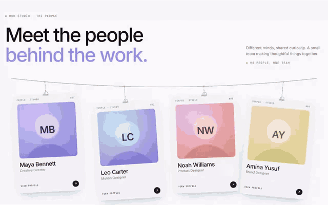

# hanging-badges



Full walkthrough: [demo/demo.mp4](demo/demo.mp4)

Team ID badges hanging from a rope, as a Web Component. They sway with spring physics, shimmer holographically on hover, and flip on click, tap or Enter to a profile back with bio, projects, contact and a QR code. Photos are optional and fall back to generated initials. Zero dependencies.

```
hanging-badges.js   the component (classic script, ~24 KB)
index.html          demo: "Meet the people" team section
demo/               walkthrough video, GIF preview, screenshot
```

## Use it

```html
<!-- optional: makes the QR codes real and scannable -->
<script src="https://cdn.jsdelivr.net/npm/qrcode-generator@1.4.4/qrcode.js"></script>
<script src="hanging-badges.js"></script>

<hanging-badges id="team" eyebrow="People · Studio"></hanging-badges>

<script>
  document.getElementById('team').people = [
    {
      name: 'Maya Bennett',
      role: 'Creative Director',
      photo: '/img/maya.jpg',          // optional
      location: 'London, UK',
      bio: 'Turning interesting ideas into things people remember.',
      projects: ['Identity / Forma', 'Campaign / Light'],
      email: 'maya@example.com',
      qr: 'https://example.com/maya'   // optional, defaults to mailto
    }
  ];
</script>
```

People can also come from a `people` JSON attribute or a child `<script type="application/json">`.

## Attributes

| attribute | meaning |
|---|---|
| `eyebrow` | label at the top of each front |
| `back-eyebrow` | label on the back, before the number |
| `cta-label` | footer text on the front (default "View profile") |
| `max-card-width` | card width cap in px (default 280) |
| `sway` | idle breeze strength, `0` to turn off |
| `theme` | `auto`, `light` or `dark` |

## API

```js
team.flip(1);          // toggle badge 1
team.flip(1, true);    // force open
team.flipAll(false);   // close all
team.addEventListener('badge-flip', e => e.detail); // { index, person, flipped }
```

Restyle with `--hb-*` custom properties (card colors, holo gradient, fonts). Rows wrap automatically to fit the width.
