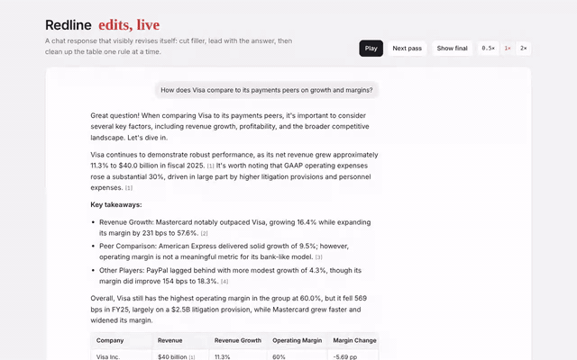

# redline



Full walkthrough: [demo/demo.mp4](demo/demo.mp4)

A player that shows an AI chat response visibly revising itself: strikethroughs, inserts, handwritten margin notes, blocks that move, and table cleanups, one pass at a time, then it leaves the clean answer in place. Zero dependencies.

```
redline.js   the player (classic script, exposes window.Redline, ~23 KB)
index.html   demo: a "Visa vs peers" answer cleaned up over 11 passes
demo/        walkthrough video, GIF preview, screenshot
```

## How it plugs in

Stream the draft as usual. When it finishes, a fast editor model returns revision passes. Redline animates them, then leaves the final answer. Users can skip at any point.

Edits are plain [CriticMarkup](https://github.com/CriticMarkup/CriticMarkup-toolkit): `{--deleted--}`, `{++inserted++}`, `{~~old~>new~~}`, `{==highlight==}`. Citations written as `[1]` render as markers. Structural changes are small JSON ops.

## Use it

```html
<script src="redline.js"></script>
<div id="player"></div>
<script>
  const player = new Redline('#player', {
    question: 'How does Visa compare to its peers?',
    blocks: [
      { id: 'b1', text: 'Visa continues to demonstrate robust performance...' },
      { id: 't', type: 'table', columns: ['Company', { text: 'Revenue', num: true }], rows: [['Visa', '40.0']] }
    ],
    passes: [
      { note: 'cut the filler', anchor: 'b1', ops: [
        { edit: 'b1', markup: "Visa{-- continues to demonstrate robust performance--}..." }
      ] },
      { note: 'right align numbers', anchor: 't', ops: [{ rootClass: 'rl-num-right' }] }
    ],
    autoplay: true
  });
</script>
```

Block types: paragraph (default), `h`, `note`, `ul`, `ol`, `table`. List items and table cells get ids like `b3.0` and `t.r1c2` / `t.h1` so passes can target them.

## Pass ops

| op | what it does |
|---|---|
| `{ edit, markup }` | rewrite a block or cell with CriticMarkup |
| `{ move, before }` / `{ move, after }` | move a block, with an arrow drawn in the margin |
| `{ rootClass }` | toggle a style on the whole answer (`rl-num-right`, `rl-mono`, `rl-scan`, `rl-cites-pill`) |
| `{ addClass, className }` / `{ removeClass, className }` | style specific blocks |
| `{ html, content }` | replace a cell's HTML (logo chips, etc.) |
| `{ addRows, rows, className }` | append table rows |
| `{ addBlock, after }` | insert a new block |
| `{ remove }` | delete blocks |

Each pass can set `note` (margin note), `anchor` (where the note sits), `hold` and `after` (timing in ms).

## API

`play()`, `step()`, `reset()`, `skipToEnd()`, `setSpeed(n)`, `load({ question, blocks, passes })`, `state()`, `destroy()`. Callbacks: `onPass(i, pass)`, `onState(state)`, `onDone()`. Theme with `--rl-ink`, `--rl-fg`, `--rl-muted`, `--rl-border` and friends. Under 760px wide it switches to a single column with inline notes.

The demo's figures are sample data, not verified.
