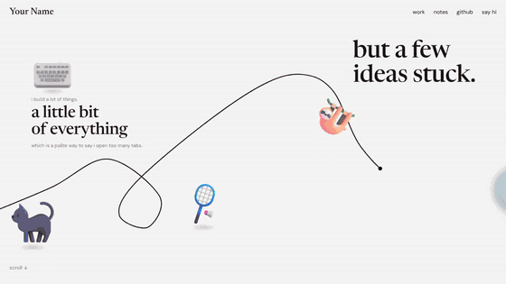

# rope-scroll



Full walkthrough: [demo/demo.mp4](demo/demo.mp4)

A horizontal scroll scene driven by normal vertical scrolling. A hand-drawn rope draws itself across the page as you scroll, a rider hangs off it just behind the tip, and objects come into focus out of a blur as they slide in from the right. Hover or tap the rider for a speech bubble. Zero dependencies, styles injected by the script.

```
rope-scroll.js   the component (classic script, ~24 KB unminified)
index.html       demo: a portfolio-style scene with placeholder copy
demo/            walkthrough video, GIF preview, screenshot
```

## Use it

```html
<div id="scene"></div>

<script src="rope-scroll.js"></script>
<script>
  RopeScroll.create(document.getElementById('scene'), {
    width: 5000,
    path: [[-60, 760], [400, 560], [1060, 262], [1640, 690], [1850, 540], [2380, 330]],
    rider: { emoji: '🦥', bubble: 'apparently i like hanging around' },
    items: [
      { x: 1240, y: 140, layout: 'text', title: 'but a few ideas stuck.', titleSize: 84, copyWidth: 520 },
      { x: 1690, y: 570, media: { emoji: '🌍', size: 200 },
        title: 'the internet came first.', body: 'fell for systems that talk to each other.' }
    ]
  });
</script>
```

Or straight from this repo:

```html
<script src="https://cdn.jsdelivr.net/gh/kabirrgrover/web-assets@main/assets/rope-scroll/rope-scroll.js"></script>
```

Everything after the scene scrolls normally once the rope reaches the end.

## Coordinate system

The scene is always **1000 units tall** and `width` units wide. It scales to fit the viewport height (and, on narrow screens, keeps at least `minScaleWidth` units across), so the composition looks the same everywhere. Every `x`, `y`, `size` and font size in the config is in these units.

**Authoring mode:** add `#debug` to the URL or press **Shift + D**. You get a 100-unit grid, numbered rope anchor points, item outlines, and a live cursor readout. Click anywhere to copy `[x, y]`, then paste it into `path` or an item.

## Options

| Option | Default | Notes |
| --- | --- | --- |
| `width` | `5000` | Scene width in units. Longer scene = more scrolling. |
| `path` | `[]` | Anchor points `[x, y]` the rope passes through. A smooth curve is fit through them. Make it cross itself for a loop. |
| `tension` | `0.5` | Curve looseness. `0` is straight segments. |
| `lead` | `0.75` | Where the drawing tip sits across the screen (0 = left edge, 1 = right edge). |
| `smooth` | `0.12` | Scroll easing per frame. `1` disables easing. |
| `revealSpan` | `0.32` | Fraction of screen width over which items go from blurred to sharp. |
| `maxBlur` | `14` | Blur in px for items not yet in view. |
| `minScaleWidth` | `600` | Narrow screens show at least this many units across. |
| `scale` | `1` | Multiplier on the fitted scale. |
| `ropeWidth` | `3.2` | Stroke width. |
| `tipRadius` | `7` | Size of the dot on the rope's end. |
| `emojiSet` | `'fluent'` | `'fluent'` renders emoji as Microsoft Fluent 3D images (same look on every OS, same set as emoji-nav). `'native'` uses the system emoji font, zero network. Falls back to native if an image is missing. |
| `emojiBase` | jsDelivr | Folder of `<codepoints>.webp` files, to self-host the Fluent set. |
| `debug` | `false` | Start with the authoring overlay on. |
| `label` | `'Scrolling scene'` | Accessible name for the region. |

### `rider`

| Key | Default | Notes |
| --- | --- | --- |
| `src` / `emoji` / `html` | `🦥` | A sloth hanging off a branch, which sits on the rope nicely. Use a transparent PNG/WebP cutout for a real photo. |
| `size` | `120` | Box size in units. |
| `anchor` | `[0.5, 0.12]` | Point in the box (0 to 1) that sits on the rope. Put it at the hands or branch. |
| `lag` | `260` | How far behind the tip the rider stays, in units of rope length. |
| `tilt` | `0.6` | How much the rider leans with the rope's slope. |
| `maxTilt` | `32` | Lean cap in degrees. |
| `flip` | `false` | Mirror the rider horizontally. |
| `bubble` | none | Text shown on hover, tap or keyboard focus. Stays level while the rider leans. |

### `items[]`

| Key | Notes |
| --- | --- |
| `x`, `y` | Top-left position in units. |
| `layout` | `row` (media left, text right, default with media), `row-reverse`, `stack`, `stack-center`, `text` (no media). |
| `media` | `{ src | emoji | html, size, alt, rotate, float: false, shadow: false }` |
| `eyebrow`, `title`, `body` | Copy. Any can be left out. |
| `titleSize` | Title font size in units (default 44). |
| `copyWidth` | Max width of the text block in units (default 380). |
| `heading` | Tag for the title, default `h2`. Use `h1` for the first item. |
| `cta` | `{ label, href }` underlined link under the copy. |
| `gap` | Space between media and text. |
| `z`, `className` | Stacking and custom styling hooks. |

## API

```js
const scene = RopeScroll.create(el, config);
scene.refresh();              // re-measure after layout changes
scene.setDebug(true);         // toggle the authoring overlay
scene.scrollToUnit(1690);     // scroll so the scene is at x = 1690 units
scene.destroy();              // remove listeners and DOM
```

## Theming

CSS custom properties, set on the scene element or any ancestor:

| Property | Default | |
| --- | --- | --- |
| `--rs-ink` | `#151515` | Titles |
| `--rs-muted` | `#7b7a77` | Eyebrow and body |
| `--rs-rope` | `#111111` | Rope and tip |
| `--rs-shadow` | `rgba(20,18,16,.22)` | Ground shadow under objects |
| `--rs-bubble` | `#1d8cff` | Speech bubble |
| `--rs-bubble-ink` | `#ffffff` | Bubble text |
| `--rs-display` | Newsreader, Georgia | Title face |
| `--rs-sans` | DM Sans, system-ui | Small text |

The demo maps these to its own light and dark tokens.

## React / Next

```jsx
'use client';
import { useEffect, useRef } from 'react';

export default function Scene({ config }) {
  const ref = useRef(null);
  useEffect(() => {
    const scene = window.RopeScroll.create(ref.current, config);
    return () => scene.destroy();
  }, [config]);
  return <div ref={ref} />;
}
```

Load `rope-scroll.js` once with a script tag (or `next/script`), or `import RopeScroll from './rope-scroll.js'` since it also exports via `module.exports`.

## Getting the look right

- The look this is based on uses real photo cutouts with transparent backgrounds (a person mid-climb, objects shot at a 3/4 angle). Fluent 3D emoji get close for free; swap in `src` cutouts for a personal site.
- Keep the background flat and light. The soft ground shadow under each object sells the "objects on a table" feel.
- Route the rope so it disappears into an object and comes out the other side, and keep it clear of the copy. Items sit above the rope, the rider above everything.
- One loop early on adds a lot of character.

## Accessibility and motion

- Content stays in normal DOM order, so screen readers read it top to bottom.
- The rider is a real button; the bubble shows on keyboard focus too.
- `prefers-reduced-motion` turns off easing, blur and the idle float.
- Sideways trackpad swipes scroll the scene.
