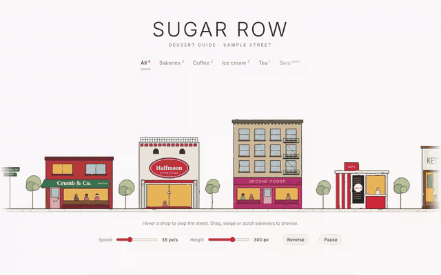

# storefront-street



Full walkthrough: [demo/demo.mp4](demo/demo.mp4)

An endlessly scrolling, hand-drawn street of storefronts as a Web Component. Feed it a list of places and each becomes a little building with a painted sign, lit windows and people inside. Hover for a tooltip, drag or scroll sideways to browse, and dark mode turns it into a night street. Zero dependencies.

```
storefront-street.js   the component (classic script, ~36 KB)
index.html             demo: "Sugar Row" dessert guide with filters and controls
demo/                  walkthrough video, GIF preview, screenshot
```

## Use it

```html
<script src="storefront-street.js"></script>

<storefront-street speed="36" height="300">
  <script type="application/json">
    [
      { "name": "Crumb & Co.", "type": "shop", "color": "#b8433b", "accent": "#2f7d55",
        "meta": "Bakery · Valencia St", "note": "Kouign-amann, sells out by 10am." },
      { "name": "Halfmoon", "type": "cafe", "accent": "#c8303a" }
    ]
  </script>
</storefront-street>
```

Or from code:

```js
const street = document.querySelector('storefront-street');
street.stores = await (await fetch('/api/places')).json();
street.addEventListener('store-select', e => router.push(`/places/${e.detail.store.id}`));
street.pause(); street.play(); street.scrollToStore('halfmoon');
```

## Building types

`shop` brick front with scalloped awning · `cafe` oval medallion sign · `walkup` apartments with fire escape · `kiosk` striped walk-up window · `gallery` wide sign, long glowing window · `modern` dark facade with picket fence · `cottage` gabled roof, pastel glow.

Street props go in `before`: `tree`, `lamp`, `gap`, or `{ "type": "signpost", "label": "Main St" }`. Leave it out and props are picked for you.

## Shop fields

| field | what it does |
|---|---|
| `name` | painted on the sign and shown in the tooltip |
| `type` | one of the building types (default `shop`) |
| `color` / `accent` / `trim` | facade, sign or awning, and frame colors |
| `sub`, `number`, `badge`, `mark` | small sign text, street number, badge word, logo glyph |
| `meta`, `note` | tooltip lines |
| `href` | makes the building a link instead of a button |
| `width`, `height`, `floors` | override the template's proportions |
| `before` | props drawn to the left of this shop |

## Attributes

| attribute | default | notes |
|---|---|---|
| `speed` | `36` | px per second; `0` makes it drag-only |
| `height` | `300` | street height in px; widths scale with it |
| `direction` | `left` | `right` reverses the drift |
| `theme` | auto | follows `data-theme` on `<html>`, then the OS |
| `props` | auto | `none` turns off automatic trees and lamps |
| `src` | | URL of a JSON file with the shop list |
| `paused` | | boolean; reduced-motion users get a still street unless `motion="always"` |

Restyle with `--ss-ink`, `--ss-lit`, `--ss-glass`, `--ss-font-script`, `--ss-font-block`, or register a new building with `StorefrontStreet.templates.myType = (store, rand) => ({ w, top, body })`.
