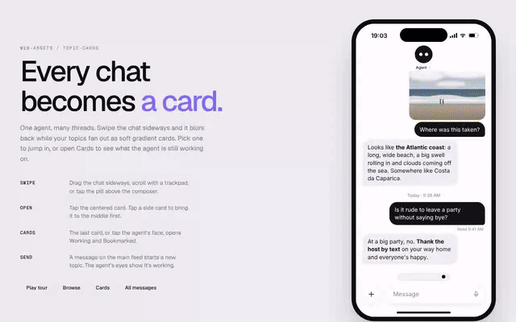

# topic-cards



Full walkthrough: [demo/demo.mp4](demo/demo.mp4)

An agent chat where every conversation becomes a card, as a Web Component. Swipe sideways and the chat blurs back while your topics fan out as soft gradient cards, with a chip strip above the composer. Open a card to jump into that thread, or open the Cards grid to see what the agent is working on (blinking eyes) and what you bookmarked. Zero dependencies, Shadow DOM.

```
topic-cards.js   the component (classic script, ~42 KB)
index.html       demo: phone frame, sample topics, canned replies
demo/            walkthrough video, GIF preview, screenshot
```

## Use it

```html
<script src="topic-cards.js"></script>

<topic-cards id="chat" style="width:390px;height:844px"></topic-cards>

<script>
  const chat = document.getElementById('chat');
  chat.agent = { name: 'Agent' };
  chat.topics = [
    {
      title: 'Wedding toast',
      date: 'Oct 6 · 9:40 PM',
      colors: ['#6f6cf2', '#d9dcff', '#4f46e5'], // optional, else generated from the title
      working: true,                              // shows eyes + "Working…"
      bookmarked: false,
      messages: [
        { from: 'user',  text: "Help me write a toast for Jamie's wedding" },
        { from: 'agent', text: 'Open with **the night you two met**…' }
      ]
    }
  ];

  // it never calls a model: you answer
  chat.addEventListener('topic-send', async (e) => {
    const answer = await myAgent(e.detail.text);
    chat.reply(e.detail.id, answer);
  });
</script>
```

List topics newest first. The main feed shows them all with the newest at the bottom; the deck and chips use the same order. Topics can also come from a `topics` JSON attribute or a child `<script type="application/json">` (an array, or `{ agent, topics }`).

### Message fields

| field | meaning |
|---|---|
| `from` | `'user'` or `'agent'` |
| `text` | supports `**bold**` and line breaks |
| `image` | image URL shown as a photo bubble |
| `attachment` | any truthy value: a document tile in the topic's colors |
| `ref` | `{ title, meta }` small linked card under the reply |
| `read` | small receipt line under the message, e.g. `'Read 9:41 AM'` |

## Attributes

| attribute | meaning |
|---|---|
| `autoplay` | loops a walkthrough until someone touches it |
| `theme` | `light` (default), `dark` or `auto` |

Size it with CSS. Use `--tc-safe-top` and `--tc-safe-bottom` to leave room for a status bar or home indicator, and `--tc-font` to change the typeface. Other `--tc-*` properties cover bubble, glass and card colors.

## API

```js
chat.browse();               // fan out the cards (optionally browse('bills'))
chat.open('bills');          // open a thread, 'all' for the main feed
chat.showCards();            // Working + Bookmarked grid
chat.close();                // back to the chat

chat.addMessage(id, msg);    // append anything
chat.reply(id, text);        // agent answer, clears "working"
chat.setWorking(id, true);   // eyes on, typing bubble
chat.addTopic({ title });    // new card at the front
chat.toggleBookmark(id);
chat.tour(); chat.stopTour();

chat.view;     // 'chat' | 'deck' | 'grid'
chat.current;  // open topic id or 'all'
```

| event | detail |
|---|---|
| `topic-send` | `{ id, text, topic }` when the user sends. On the main feed this first creates a new topic. |
| `topic-create` | `{ topic }` |
| `topic-open` | `{ id, topic }` |
| `bookmark` | `{ id, bookmarked }` |
| `view-change` | `{ view, topic }` |

Input: drag the chat sideways, scroll sideways on a trackpad, or tap the pill above the composer to open the deck. Tap the center card to open it, a side card to bring it to center. Arrow keys move, Enter opens, Escape backs out. Tap the agent's face for the grid.
